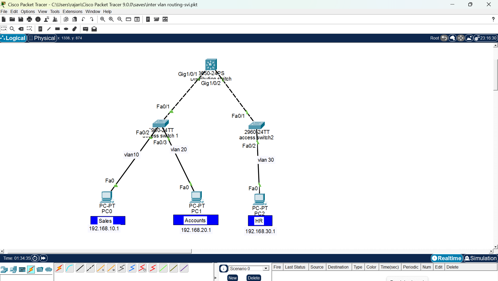

# Lab 2 - Inter-VLAN Routing using SVI (Packet Tracer)

In Lab 1 I did routing between two subnets using a router. This time I tried inter-VLAN routing on a multilayer switch with SVIs.

Tool: Cisco Packet Tracer 9.0
Packet Tracer file: `inter-vlan-routing-svi.pkt`

## Topology

- Distribution switch: 3650-24PS
- Access switch 1 (2960): PC0 in VLAN 10, PC1 in VLAN 20
- Access switch 2 (2960): PC2 in VLAN 30
- Trunk links between access switches and the 3650, with Native VLAN 100

## VLANs and IPs

| VLAN | Name | Network | PC | PC IP | SVI Gateway IP |
|------|------|---------|----|-------|----------------|
| 10 | Sales | 192.168.10.0/24 | PC0 | 192.168.10.1 | 192.168.10.100 |
| 20 | Accounts | 192.168.20.0/24 | PC1 | 192.168.20.1 | 192.168.20.100 |
| 30 | HR | 192.168.30.0/24 | PC2 | 192.168.30.1 | 192.168.30.100 |
| 100 | native | - | - | - | - |

Each VLAN uses its SVI on the 3650 as the default gateway.

## What I did

- Created VLANs 10, 20, 30 and VLAN 100 (native) with names
- Put PC ports in their respective VLANs
- Configured trunk links between switches and set Native VLAN 100
- Turned on `ip routing` on the 3650 and configured SVIs for VLANs 10, 20, and 30
- Assigned static IP addresses and gateways on PC0, PC1, and PC2

## Verification & Testing

Checked switch status first with `show vlan brief`, `show interfaces trunk`, `show ip interface brief`, and `show ip route` so VLANs, trunks, SVIs (`up/up`), and connected routes were all in place.

From PC2 I pinged PC0 and PC1, and from PC0 I pinged PC1 and PC2. Replies came back with TTL 127, showing traffic routed through the 3650.

On PC0 the first ping timed out and the next ones succeeded—standard ARP behavior on the initial packet, with no drops afterward.

Screenshots in this folder: `topology.png`, `ping-test.png`, `Distribution-switch-config.png`

## Problems I faced

- **Native VLAN mismatch:** Set Native VLAN 100 on the access switches first while the 3650 trunk ports were still on VLAN 1, causing `%CDP-4-NATIVE_VLAN_MISMATCH` and STP port block messages. Configured `switchport trunk native vlan 100` on `GigabitEthernet1/0/1` and `GigabitEthernet1/0/2` on the 3650 to fix it.
- **Trunk encapsulation command:** `switchport trunk encapsulation dot1q` gave an invalid input error on this Packet Tracer 3650 switch since dot1q is the only option here, so I used `switchport mode trunk` directly.
- **Hostname with space:** `hostname Distribution switch` failed because of the space, so I renamed it to `Distribution-switch`.

## Configs

Saved running configs in this folder:
- `Distribution-switch.txt`
- `Access-switch1.txt`
- `Access-switch2.txt`
